## First indicators
What actually caught my attention when analyzing this APK was that even though the app declared only 7 classes, the file's size was around 46 MB. 
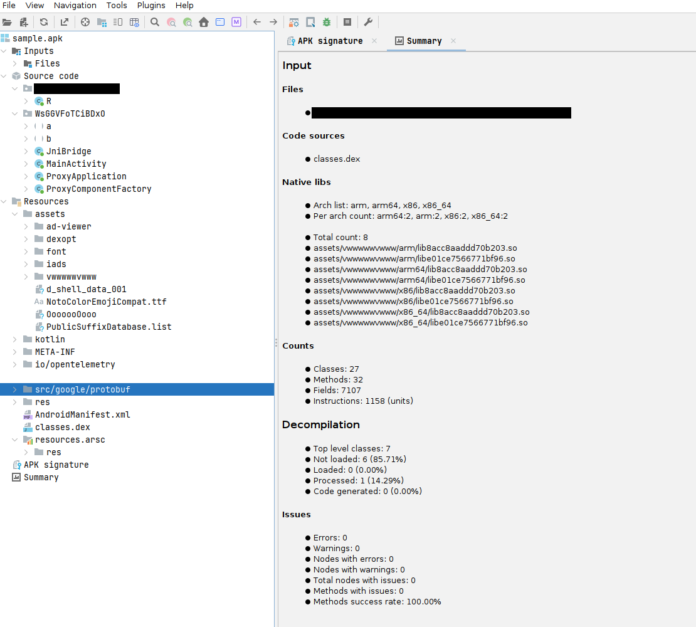

This is the first strong indicator of an app being packed. Moreover, if someone is already familiar with the packer itself, a crucial asset artifact, `d_shell_data_001`, can already be spotted. 
So how does this work? 

Shannon entropy calculated on the .dex file will reveal a strong indicator: 
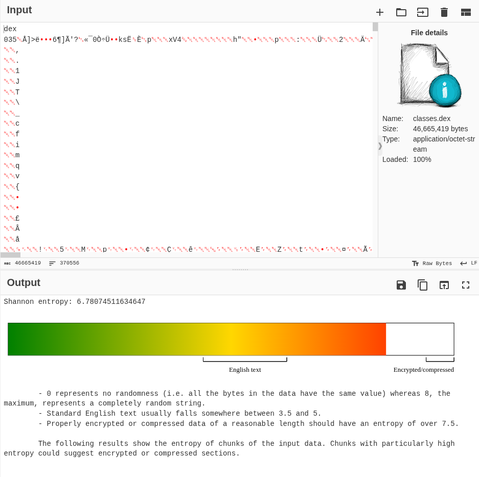

The entropy value alone is suggestive: **6.78** for the whole file is far too high for a DEX that only holds the shell loader. 

### Confirming the hidden ZIP
Let's inspect the dex header:

```bash
$ unzip -o sample.apk classes.dex -d apk/
Archive:  sample.apk
  inflating: apk/classes.dex
  
$ xxd -l 0x70 apk/classes.dex
00000000: 6465 780a 3033 3500 c55d 3eeb 9799 8136  dex.035..]>....6
00000010: b65d c327 3f02 abaf 30d2 f7dc 8791 6b73  .].'?...0.....ks
00000020: cb0e c802 7000 0000 7856 3412 0000 0000  ....p...xV4.....
00000030: 0000 0000 6822 0000 9b00 0000 7000 0000  ....h"......p...
00000040: 3a00 0000 dc02 0000 3200 0000 c403 0000  :.......2.......
00000050: 0900 0000 1c06 0000 6100 0000 6406 0000  ........a...d...
00000060: 0600 0000 6c09 0000 e818 0000 2c0a 0000  ....l.......,...


```

Each field is a 32-bit little-endian value:
- at offset **0x20** there's the **file_size** field: 0x02C80ECB = 46,665,419 (the whole file);
- then at **0x24** we find the **header_size**;
- at **0x34** there's **map_off**: 0x2268;
- at **0x68** there's **data_size**: 0x18E8;
- finally, at **0x6c** we can find **data_off**: 0xA2C.
 
The obvious field, `file_size` at header offset 0x20, is useless here: the packer patched it to **46,665,419**, the size of the whole file, so it looks perfectly legitimate. The real boundary comes from the end of the data section: *map_off* points to the map list, the last structure in the data section of the file. It sits at 0x2268, holds 14 entries and ends exactly where the data section ends.  
We can do the math with the rest: *data_off* + *data_size* = 0xA2C + 0x18E8 = 0x2314.

Supporting this, jadx-gui offers a very practical hexadecimal view of the classes.dex file that can be used to look at suspicious artifacts that might suggest the presence of something unexpected inside the file: 
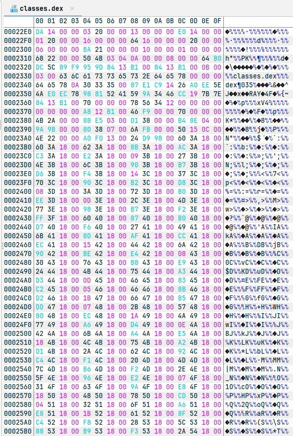

We can clearly observe a ZIP hidden at 0x2314: ART only follows offsets that point inside the DEX structures, so it never touches anything after 0x2314. That's exactly where the `PK\x03\x04` from the screenshot above sits.

The local file header at 0x2314 also tells us the archive is **not compressed**:

```bash
$ xxd -s 0x2314 -l 52 apk/classes.dex
00002314: 504b 0304 0a00 0008 0000 64b0 dc5c 89f9  PK........d..\..
00002324: 959d 8413 b100 8413 b100 0b00 0300 636c  ..............cl
00002334: 6173 7365 732e 6465 7800 0000 6465 780a  asses.dex...dex.
00002344: 3033 3500 ...                            035.
```

- compression method `00 00` = **stored**
- compressed size = uncompressed size = `0x00b11384` = 11,604,868 bytes
- the entry is named `classes.dex`, and the `dex\n035` magic follows right after it

The end of the file reveals the whole structure: 
```bash
# Show the last bytes of classes.dex with a negative seek
$ xxd -s -30 apk/classes.dex
02c80ead: 2e64 6578 504b 0506 0000 0000 0700 0700  .dexPK..........
02c80ebd: 9501 0000 08ea c702 0000 02c7 ebb3       ..............
```

The end-of-central-directory record (`PK\x05\x06`) lists 7 entries (07 00 is read as 0x0007), followed by 4 bytes `02 c7 eb b3`. 

### Carving the real DEX files
With a simple script it was possible to iterate through the file's bytes and detect targeted signatures:
```python
# Loading the file
path = args.dex
try:
	with open(path, 'rb') as f:
		d = f.read()
except OSError as e:
	die(f'{path}: {e}')

# Reads an unsigned 32-bit little-endian integer at offset 'o'.
u32 = lambda o: struct.unpack_from('<I', d, o)[0]

# Header parsing 
fields = {
    'checksum':        u32(0x08),   
    'file_size':       u32(0x20),   
    'map_off':         u32(0x34),   
    'method_ids_size': u32(0x58),   
    'class_defs_size': u32(0x60),   
    'data_size':       u32(0x68),   
    'data_off':        u32(0x6C),   
}
version = d[4:7].decode(errors='replace')

# Section boundaries
file_size = fields['file_size']
map_end   = fields['map_off'] + 4 + u32(fields['map_off']) * 12
data_end  = fields['data_off'] + fields['data_size']

# Scanning for signatures
sig_hits = {}
for sig in (b'dex\n03', b'PK\x03\x04'): # Searches for DEX or ZIP files
    hits, i = [], d.find(sig, 0x70)     # Starts past the stub's header
    while i != -1 and len(hits) < 20:
        hits.append(i)
        i = d.find(sig, i + 1)
    sig_hits[sig.hex()] = hits

# Shannon entropy in bits per byte; it measures only the first MB of the file
def entropy(b):
    if not b:
        return 0.0
    c = collections.Counter(b)
    return -sum(v / len(b) * math.log2(v / len(b)) for v in c.values())
    
# Handling ZIPs by starting from the archive's end
def parse_zip(lo):
	# finds the last EOCD signature
    eocd = d.rfind(b'PK\x05\x06', lo) # 'lo' is the end of the stub
    if eocd < 0 or eocd + 22 > len(d):
        return None
        
    # It walks the central directory
    _, _, _, total, cd_size, cd_off, clen = struct.unpack_from('<4x4HIIH', d, eocd)
    start = eocd - cd_size - cd_off
    if start < lo or d[start:start + 4] != b'PK\x03\x04':
        return None

    entries, p = [], start + cd_off
    for _ in range(total):
        if d[p:p + 4] != b'PK\x01\x02':
            break
        try:
            (_, _, flags, method, _, _, crc, csize, usize, nlen, xlen, clen_e, _, _, _, lh) = struct.unpack_from('<4x6H3I5H2I', d, p)
            name = d[p + 46:p + 46 + nlen].decode('utf-8', 'replace')
            lho = start + lh  # It computes the local header             
            lnlen, lxlen = struct.unpack_from('<HH', d, lho + 26)
        except struct.error:
            break
        data_off = lho + 30 + lnlen + lxlen                   
        entries.append({'name': name, 'method': method, 'flags': flags, 'crc32': crc,
                        'csize': csize, 'usize': usize, 'data_off': data_off,
                        'is_dex': d[data_off:data_off + 4] == b'dex\n'})
        p += 46 + nlen + xlen + clen_e
    return {'type': 'zip', 'start': start, 'end': eocd + 22 + clen, 'entries': entries}
```

The script loads the dex file as an argument, performs some integrity checks and then produces a JSON holding the header fields, the boundaries, the signature hits, the verdict and the payload details. 
The tool's output looks similar to this:
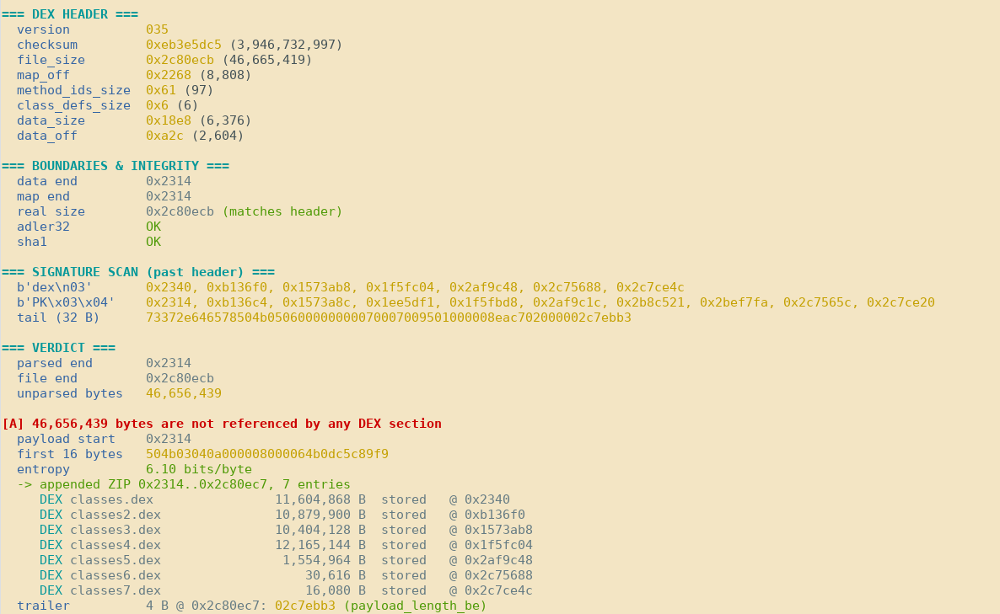

From the output there's one very important section that we need to look at: the verdict one.

*unparsed bytes 46,656,439 
[A] 46,656,439 bytes are not referenced by any DEX section*

This basically means that **99.98% of this file is completely invisible to the Android compiler**. It is dead space that Android's runtime never reads during standard loading.

Merely extracting the ZIP appended at the end of classes.dex won't solve the problem for us.
`carve.py` takes the JSON report as input and returns the 7 DEX files: 
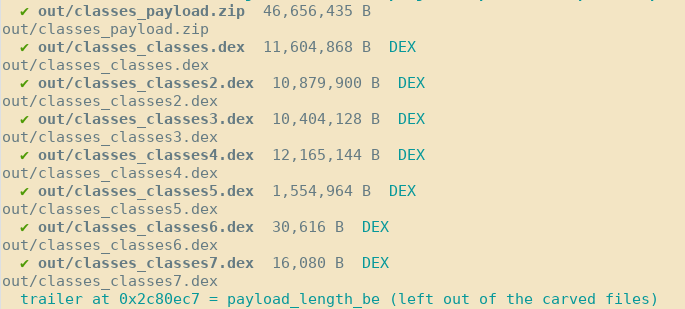

Opening these in jadx is disappointing, though. Class and method names are all there, but a large share of method bodies decompile to garbage or fail outright. The DEX files are **hollowed**: the structure is intact, but the instruction bytes of protected methods were replaced with random data. The real code lives somewhere else:
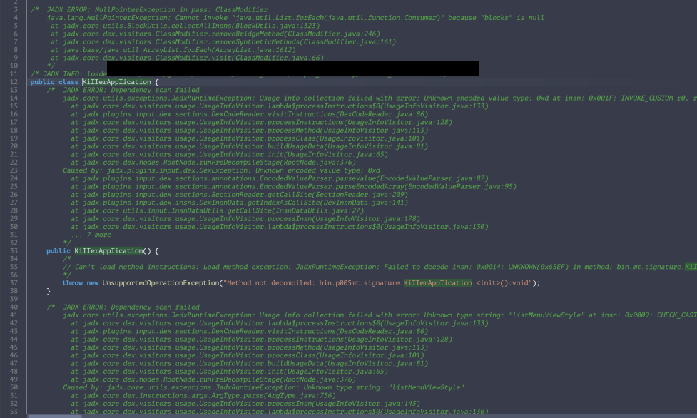

The unpacking stub, however, keeps a suspicious encrypted file with no extension, which I believe is the blob containing the actual logic of the application (by exclusion, because no other interesting files of relevant size were found):
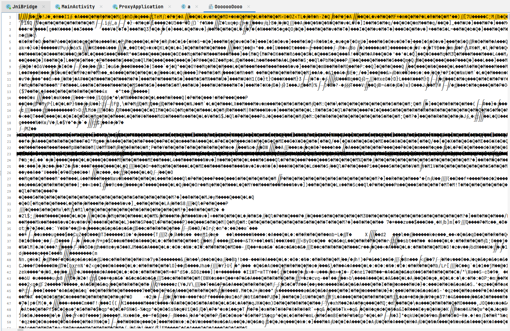

Facing this, I decided to dig into the native library in order to understand how the packer really hides its payload.
## Native library analysis
### a.c(sourceDir, dataDir) 
This method extracts the native payload: it retrieves the ISA via reflection, locates the entry `assets/vwwwwwvwww/<isa>/libe01ce7566771bf96.so` in the APK and extracts it to `<dataDir>/dpt-libs/<isa>/`. 
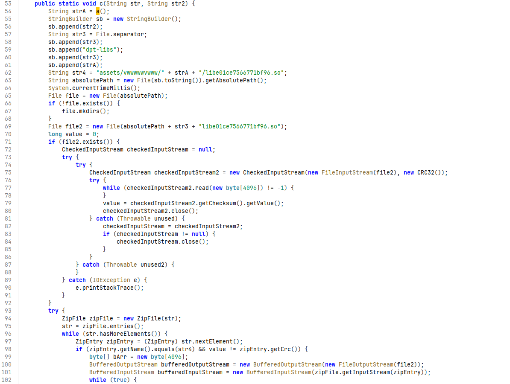
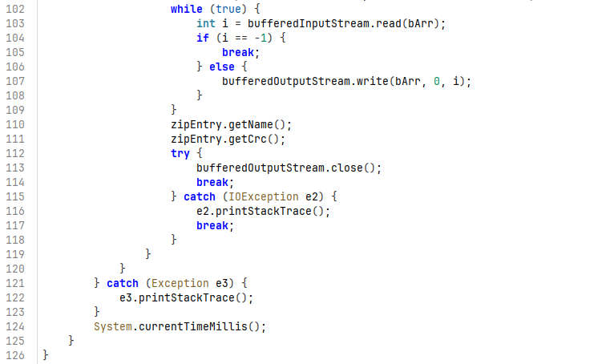

### Library loading 
It happens inside the JniBridge class:
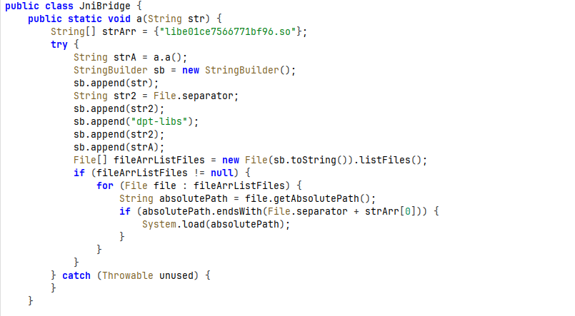

### Native code analysis
Jumping into Ghidra, we can rapidly observe the obfuscated state of this ELF file, with no functions exported. The actual asset name containing the code is obfuscated and won't be found inside the Strings section of the library:
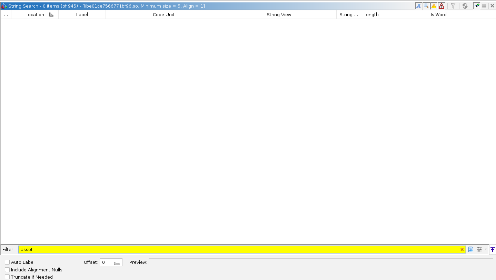
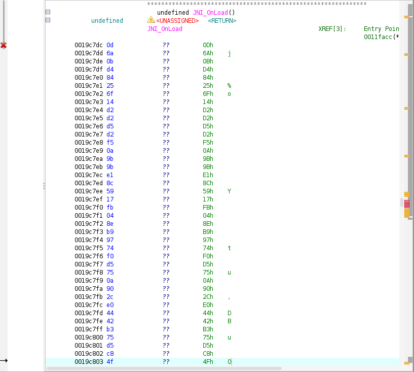

The ELF contains no `AAssetManager_*` functions, only manual file I/O functions such as `fopen`, `fread`, `fseek`, `read`, `mmap` and `lseek`, and manual decompression functions like `inflateInit2_`, `inflate` and `inflateEnd` (from zlib).
So the code must get the path to the APK file itself, open it with `fopen`/`mmap`, manually parse the ZIP headers, find the `assets/OoooooOooo` entry and use `inflate` to decompress it into memory.

`inflate` has only one reference:
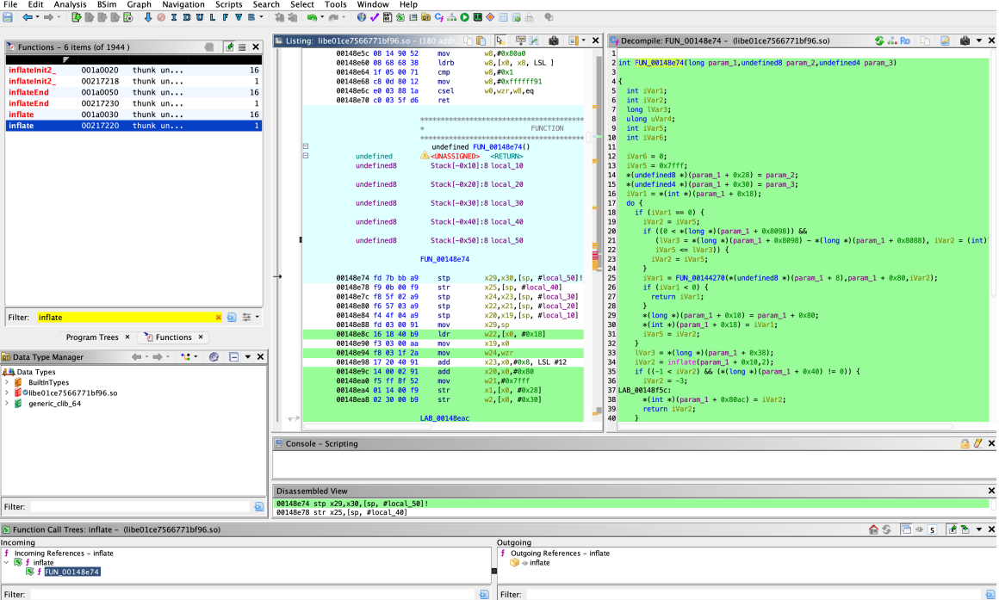

However, the packer uses a generic C struct or C++ vtable for file I/O operations (like a custom Stream interface with pointers to read, write, seek, inflate, etc.). Because of this, the inflateWrap function is called indirectly (e.g., stream->read(buffer, size)). That's why the direct cross-references don't point to the main unpacking logic:
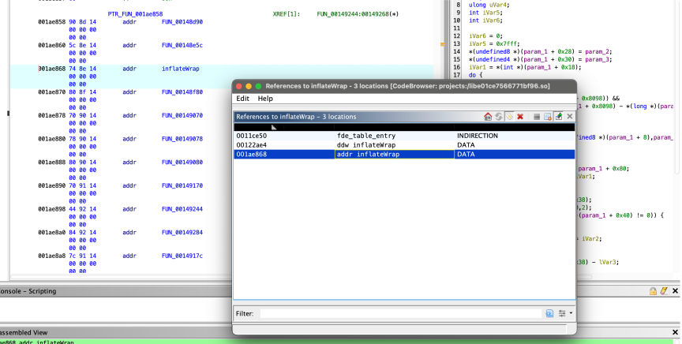

Since this packer uses C++ object-oriented streams, the actual reading/decrypting is likely another method inside that same virtual table. Taking a look at the vtable: 
- 001ae860 addr FUN_00148e5c 
- 001ae868 addr inflateWrap (FUN_00148e74) 
- 001ae870 addr FUN_00148f80 <--- Likely the "Read" method! 
- 001ae878 addr FUN_00149070

Further analysis has shown that none of these functions is actually useful for the decryption routine. One important aspect I was overlooking is that the ELF contains a non-standard section called .bitcode:
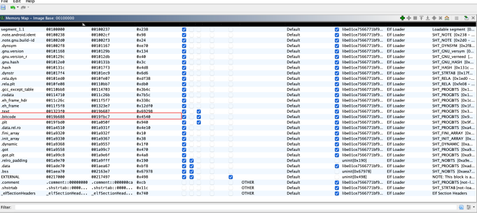

Its name is referenced in INIT_2: 
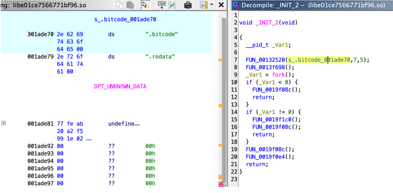

This is the actual routine that decrypts .bitcode at load time. Let's jump into `FUN_00132520`:
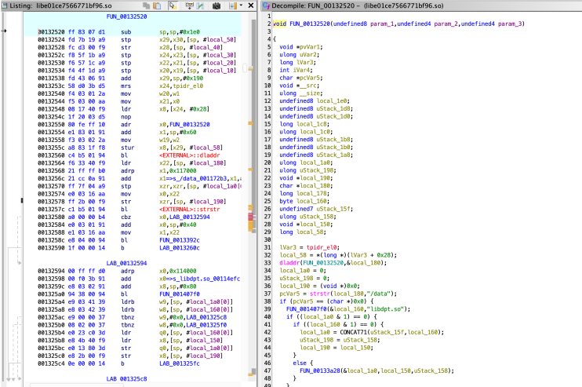
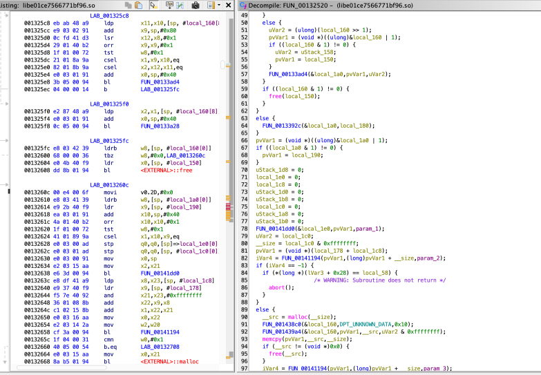
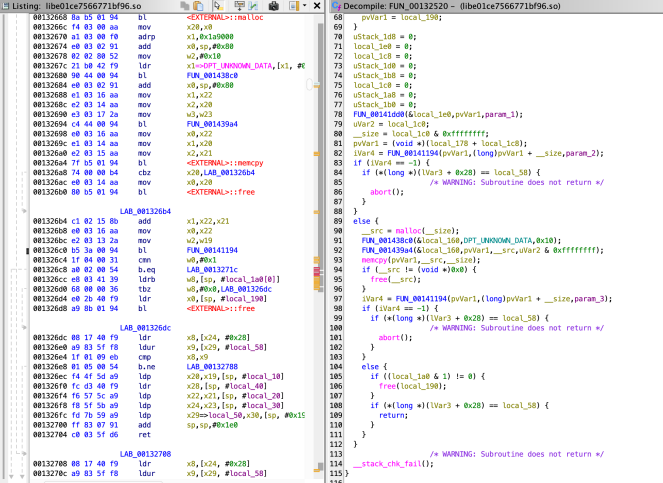

`FUN_00141dd0(&local_1e0,pvVar1,param_1)`, which is actually `FUN_00141dd0(&sh, path, ".bitcode")`, parses the ELF section headers and returns the .bitcode header (address and size):

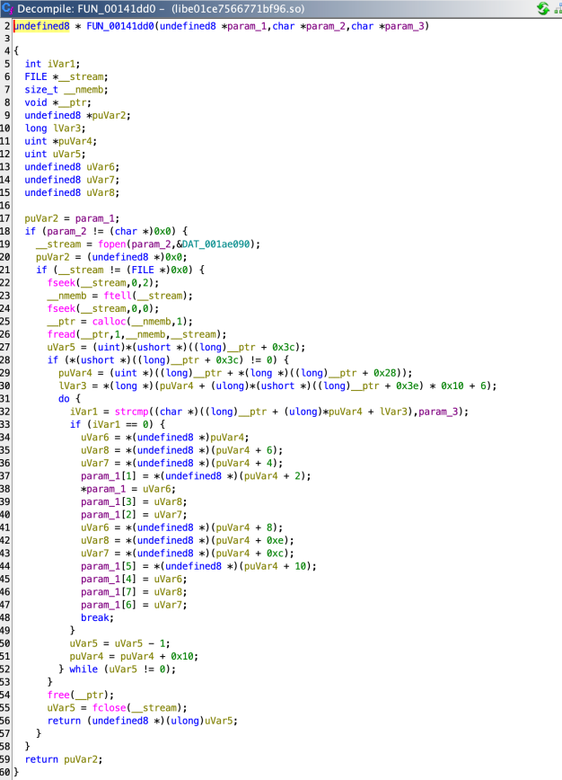

Then we have `FUN_001438c0(S, DPT_UNKNOWN_DATA, 0x10)` that actually performs the RC4 key setup:
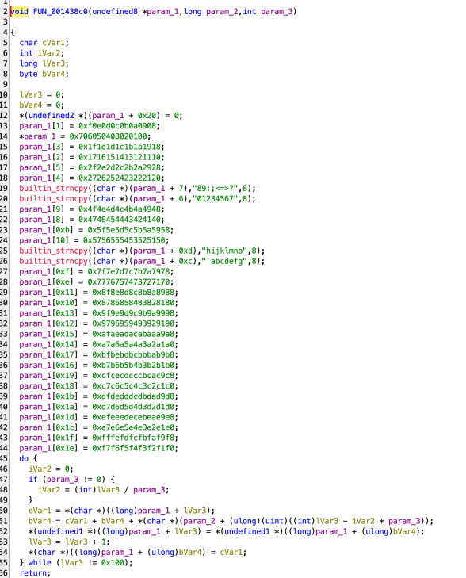

Moreover, the decryption routine handles the key's reference: exactly 16 bytes, stored in .rodata:
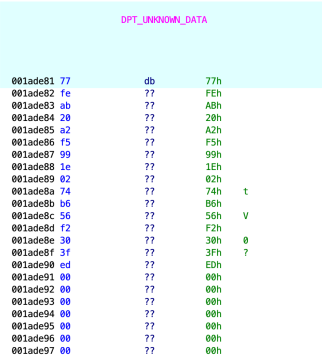

The custom RC4 key is:
`77 fe ab 20 a2 f5 99 1e 02 74 b6 56 f2 30 3f ed`

The key, however, works neither for the config file nor for the blob asset, and this is why: another method also uses the key, at 0x132a4c:
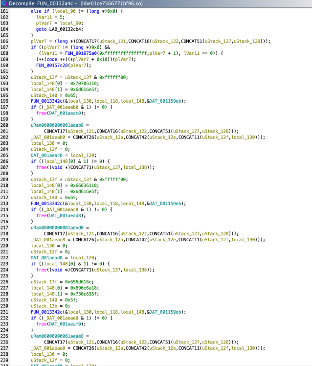

Inside this function we can observe how the author mutates the master RC4 key. At some point we can observe the following set of instructions:
```
local_148[0] = 0x70706110;
local_148[1] = 0x6d616e5f;
uStack_140 = 0x65
[...]
local_148[0] = 0x66636110;
local_148[1] = 0x6d616e5f;
[...]
```
If we join those hex values together, reverse the endianness, pad the leftover byte with zeros to 8 hex characters and convert them to ASCII, we get the following:
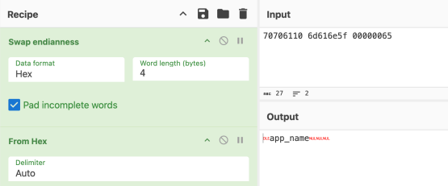

Applying the previous recipe (endianness already swapped) to all the hexadecimal values:
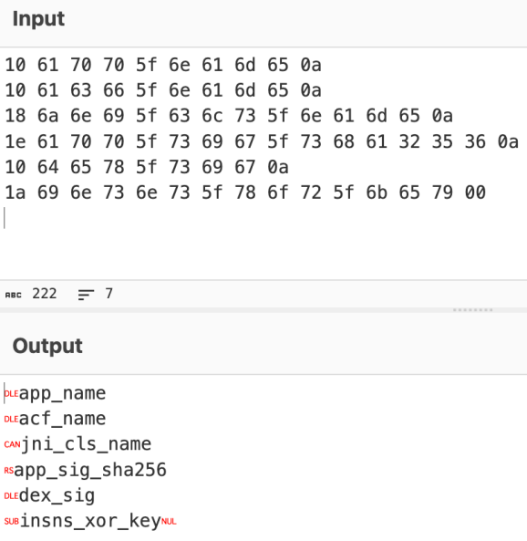

These look like configuration fields to me, along with an XOR key that is potentially used for further decryption.
Back to the function, it manually overwrites two bytes of the master key right before decrypting it:
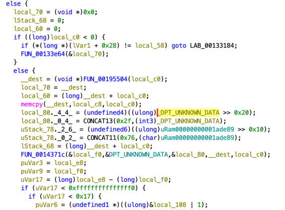

- `CONCAT13(0x2f, ...)` : Replaces the 4th byte of the key (`0x20`) with `0x2F`.
- `CONCAT11(0x76, ...)` : Replaces the 10th byte of the key (`0x74`) with `0x76`.

So in the end we obtain:
- **Original key:** `77 fe ab 20 a2 f5 99 1e 02 74 b6 56 f2 30 3f ed`
- **Mutated key:** `77 fe ab 2F a2 f5 99 1e 02 76 b6 56 f2 30 3f ed`

We can also observe how it passes both the original key (`&DPT_UNKNOWN_DATA`) and the mutated key (`&local_80`) to the decryption function, but RC4 only takes one key.
A cipher that takes two 16-byte keys (a key and an initialization vector, or IV) and operates on a file that is exactly 240 bytes (a perfect multiple of 16) is AES-128 in CBC mode.

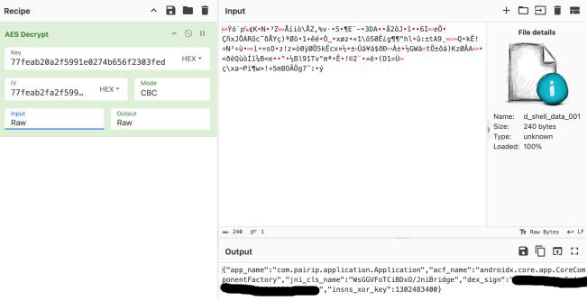

Done! The configuration file has been decrypted! The same results can be achieved by using pycryptodome in a Python script, but `openssl` works just as well:

```bash
openssl enc -d -aes-128-cbc \
  -K 77feab20a2f5991e0274b656f2303fed \
  -iv 77feab2fa2f5991e0276b656f2303fed \
  -in apk/assets/d_shell_data_001
```


`app_name` and `acf_name` are the original Application and AppComponentFactory that the proxies hand control back to. The only field needed for unpacking is `insns_xor_key`: `1302483400` = `0x4DA251C8` = bytes `c8 51 a2 4d` (little-endian).

The complete schema is:
1. **The Library**: It hides its core inside an RC4-encrypted .bitcode section. 
2. **The Config**: It reads d_shell_data_001 and decrypts it using AES-128-CBC with a mutated hardcoded key to get the JSON shown above. 
3. **The Payload**: It reads `OoooooOooo`, unzips it in memory, and uses the insns_xor_key from the JSON to XOR-decrypt the missing method bodies. 
4. **The Handoff**: It drops the hollowed DEX files (`i11111i111.zip`), hooks ART and patches the XOR'd bytes back in at runtime.

Now, having `"insns_xor_key":1302483400`, the next steps are:
- Convert the integer to hex --> `0x4DA251C8`
- Swap endianness because Android is little-endian --> `\xc8\x51\xa2\x4d`
- Reconstruct the actual DEX code

Here is a short PoC showing that the found key can actually be used to reconstruct the whole code:
- Extract the blob header:  
```
	$ xxd -l 64 assets/OoooooOooo 
	00000000: 0200 0600 1c00 0000 4ea0 1200 d021 1500  ........N....!..
	00000010: 4a95 1600 2ce4 4800 9a86 4900 311b 0000  J...,.H...I.1...
	00000020: 0000 2000 0000 b841 82b9 c851 ac4d c852  .. ....A...Q.M.R
	00000030: ad4d c951 a24d 6369 9168 4419 df71 e8cf  .M.Q.Mci.hD..q..
```
- `b8 41 82 b9` XOR `c8 51 a2 4d` = `70 10 20 f4` -> `invoke-direct {v0}, method@f420`
